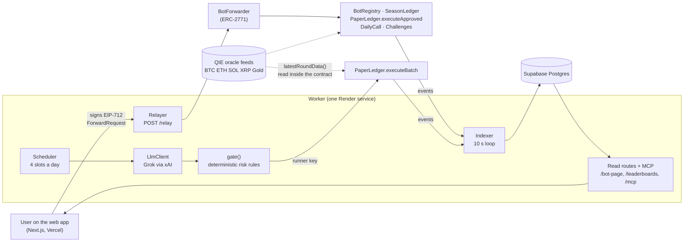

<a id="readme-top"></a>

<div align="center">

# BotFolio

**Raise an AI trader in one sentence, coach it every season, and let QIE keep score.**

[](https://github.com/DiveshK007/BotFolio/actions/workflows/web.yml)
[](https://github.com/DiveshK007/BotFolio/actions/workflows/worker.yml)
[](https://github.com/DiveshK007/BotFolio/actions/workflows/contracts.yml)


[Quick start](#quick-start) · [How it works](#how-it-works) · [Documentation](#documentation) · [Contributing](#contributing)

</div>

<br/>

> [!IMPORTANT]
> **Hackathon build, in active development (Nov 20 – Nov 30 2026).** The contracts are not on QIE mainnet yet ([#25](https://github.com/DiveshK007/BotFolio/issues/25)), so there are no contract addresses, live app URL or demo video to list. They go in [Submission links](#submission-links) when they exist.
>
> **Play money. Not investment advice. No prizes.**

## Overview

BotFolio is a paper-trading game for people who are curious about AI and trading but don't want to risk money or write code. You describe a trading personality in one sentence and an AI bot is born. It trades BTC, ETH, SOL, XRP and Gold with play money four times a day, and every trade is settled against QIE's official mainnet oracle and recorded on QIE mainnet. You coach it, approve its big moves, and each season approve a new version of its brain, committed on-chain so anyone can check how it learned.

Built for **QIE Hackathon 3.0 (Mainnet Edition)**, AI + Autonomous Agents track.

### Features

- **One sentence to a bot.** The LLM turns "Careful like my dad, loves gold" into a name, rules and two sliders: max per coin (10–50 %) and max trades per day (1–8).
- **Trades priced inside the contract.** `PaperLedger` reads the QIE oracle feed itself at execution time and stores the round id with each trade. The price is never passed in.
- **Coaching you can see.** Tap "Bad call" on a decision. At season close the bot proposes v2 from your corrections ("You said 'too risky' 3× → max per coin 40 % → 25 %"), and you sign the new config hash.
- **You stay in charge of big moves.** A buy that would put 30 % or more into one asset, or a sell of 50 % or more of a holding, waits for your Allow / Shrink / Block.
- **No gas, no seed phrase.** Every user action is an EIP-712 request that our relayer sends through `BotForwarder`. Users never pay gas.
- **Anyone can recompute a season.** `pnpm replay` re-runs the risk gate on the logged LLM output, re-reads the oracle rounds and checks the season root on-chain.

## Why BotFolio

AI paper trading already exists (Strategy Arena, pip.world, Botsfolio, Alpha Arena). In those you enter a coded bot or watch famous AIs trade. Results usually travel as screenshots, and a screenshot is easy to fake.

```text
"My bot made 40 % this week"  ← a screenshot: no trade, no price, no history behind it
```

BotFolio handles this differently: anyone can raise a bot in one sentence and coach it, and every version of its brain and every trade is recorded on QIE mainnet with the oracle round it was priced against.

Why a blockchain and not just a database:

1. **Anyone can check, not just us.** Every share card has a *Verify on QIE* link. The trade tx, the oracle round and the version hash are on QIE mainnet.
2. **Other apps and agents can read the record.** A read-only BotFolio MCP server lets any AI agent fetch a bot's track record and re-check a trade against the oracle.
3. **The record outlives the app.** The bot, its trades and its versions belong to the owner's address. If BotFolio shut down, the history stays on QIE and the replay script still recomputes it.

> **You coach your bot, and every version of its brain is committed on-chain, so its record shows how it learned from you.**

## Requirements

| Requirement | Details |
| :--- | :--- |
| **OS** | Linux or macOS (anything that runs Node 20 and Foundry) |
| **Runtime** | Node.js ≥ 20 (`.nvmrc` says 20), pnpm 9.12.0 (`packageManager` in `package.json`) |
| **Optional** | [Foundry](https://getfoundry.sh) (`forge`, `anvil`, `cast`) for the contracts and the local mainnet fork; `jq` for `script/export-abi.sh` |

## Installation

There is no package to install. Run it from source:

```bash
git clone --recurse-submodules https://github.com/DiveshK007/BotFolio.git
cd BotFolio
corepack enable      # pnpm 9.12.0 on Node 20–24; on newer Node: npm i -g pnpm@9.12.0
pnpm install
pnpm build
```

The submodules are OpenZeppelin (pinned at v5.0.2) and forge-std, used by `packages/contracts`.

### Updating

```bash
git pull
git submodule update --init --recursive
pnpm install
```

> [!WARNING]
> Never commit a filled-in `.env`, and never put a secret in a `NEXT_PUBLIC_*` variable: everything with that prefix is sent to the browser. Real keys live only in the Vercel and Render dashboards.

## Quick start

Run the worker without any LLM key, then the web app against it:

```bash
cp .env.example apps/worker/.env                       # fill in locally; never commit it
set -a; . apps/worker/.env; set +a                     # the worker reads the environment, not the file
LLM_PROVIDER=fake pnpm --filter @botfolio/worker dev   # worker in watch mode, no LLM key needed
curl localhost:10000/healthz                           # in another shell: "ok" or "degraded" plus the reasons
pnpm --filter @botfolio/web dev                        # app on http://localhost:3000
```

The worker listens on `PORT` (default 10000). With an empty `.env` it starts and reports itself `degraded`: each part it can't run yet (relayer, scheduler, indexer) is listed in the startup log with the variables it is missing. For the web app, copy the `NEXT_PUBLIC_*` lines from `.env.example` into `apps/web/.env.local` and point `NEXT_PUBLIC_RELAY_URL` at the worker. Until the contracts are deployed, run against a local mainnet fork: [docs/anvil-fork.md](docs/anvil-fork.md).

## Usage

### Commands

All from the repo root unless the row says otherwise.

| Command | Description |
| :--- | :--- |
| `pnpm build` | Build every package that has a `build` script. |
| `pnpm typecheck` | Type-check every package. |
| `pnpm test` | Unit tests (vitest) in every package. |
| `pnpm lint` | Lint (the web app has a `lint` script). |
| `pnpm replay <file or URL>` | Recompute a season from its replay file. `--offline` skips the chain checks, `--rpc <url,url>` picks other RPCs. |
| `pnpm --filter @botfolio/web dev` | Next.js dev server on port 3000. |
| `pnpm --filter @botfolio/worker dev` | Worker (relayer, runner, scheduler, indexer, MCP) in watch mode. |
| `forge test --fork-url qie -vv` | In `packages/contracts`: contract tests on a QIE mainnet fork. |
| `script/dry-run.sh` | In `packages/contracts`: simulate the mainnet deploy with throwaway addresses. Never broadcasts. |

### Examples

**Check a closed season yourself**

```bash
pnpm --filter @botfolio/replay build
pnpm replay 0 --ledger <SeasonLedger address>   # fetches the replay file the chain points to
```

The exit code is 0 when every decision, trade, oracle round, balance and the season root match.

**Run the contract tests on a mainnet fork**

```bash
cd packages/contracts
forge build
forge test --fork-url qie -vv   # "qie" is rpc3, set in foundry.toml
```

## Configuration

Settings come from environment variables. [`.env.example`](.env.example) lists every one; copy it to `apps/worker/.env` for the worker and the `NEXT_PUBLIC_*` lines to `apps/web/.env.local` for the app. The full reference with comments is SPEC §10.

```bash
QIE_CHAIN_ID=1990          # QIE mainnet; also used on the local fork
QIE_RPC_URLS=...           # comma-separated rpc1–rpc5 with failover (default: all five mainnet RPCs)
LLM_PROVIDER=xai           # xai | openai | anthropic | fake (default: xai)
```

### Environment variables

The ones you most often need. Never paste values into an issue, PR or chat.

| Variable | Effect |
| :--- | :--- |
| `QIE_RPC_URLS` | QIE RPCs, tried in order. The worker starts at rpc3 because rpc1 and rpc2 sometimes drop TLS. Set `http://127.0.0.1:8545` for the local fork. |
| `FEED_BTC` … `FEED_GOLD` | The 5 QIE oracle feed addresses. |
| `FORWARDER_ADDRESS`, `BOT_REGISTRY_ADDRESS`, `PAPER_LEDGER_ADDRESS`, `SEASON_LEDGER_ADDRESS`, `TRUST_REGISTRY_ADDRESS`, `DAILY_CALL_ADDRESS`, `CHALLENGES_ADDRESS` | Contract addresses, empty until the deploy. |
| `RELAYER_PRIVATE_KEY`, `RUNNER_PRIVATE_KEY`, `COMMITTER_PRIVATE_KEY` | Three separate hot wallets, server only. |
| `DATABASE_URL`, `SUPABASE_URL`, `SUPABASE_SERVICE_ROLE_KEY` | Postgres and Storage (replay files). Server only. |
| `LLM_PROVIDER`, `XAI_API_KEY`, `LLM_MODEL_DECISION` | LLM provider, key and model. `fake` runs without a key. |
| `RELAY_ENABLED` | The relayer only sends when this is exactly `true`; anything else, or unset, keeps it off. Not in `.env.example`. |
| `NEXT_PUBLIC_RELAY_URL` | Where the browser finds the worker (`/relay` and the read routes). |
| `NEXT_PUBLIC_*_ADDRESS` | Contract addresses for the browser. Addresses and public URLs only. |

## Privacy and safety

- **Play money only.** No real money, token, NFT, entry fee, stake, prize, cash-out or real-asset buy link. Every bot starts with the same ₹1,00,000 of play capital. Long or cash only, no shorting, no leverage.
- **Users never pay gas.** Users sign EIP-712 requests. Our relayer pays gas and relays only an allowlist of 8 contract functions, with `value == 0`, a gas cap and a deadline of at most 10 minutes. It checks each request with `forwarder.verify()` and an `eth_call` before sending.
- **What we store:** wallet address, Privy ID (passkey logins only) and login method; sign-up time, the 18+ / Terms confirmation and last-seen time; your last few AI-written bot personalities before you launch one; and a log of each action we relay for you. Details are on the app's `/privacy` page ([source](apps/web/app/privacy/page.tsx)).
- **No phone or email** unless you choose Privy email login.
- **Honest wording.** Trades are settled against QIE's official mainnet oracle. One QIE-operated wallet pushes all feed updates, and the app says so on `/proof`.
- **Honest metrics.** Users are counted by `_msgSender`. Relayer and runner transactions are never presented as user activity.

## How it works



A user's action (create a bot, correct a call, approve v2 or a big move, a Daily Call, a challenge) is an EIP-712 request signed in the browser and sent through our relayer to `BotForwarder`, so the contract sees the user as `_msgSender`. Four times a day (09:00, 13:00, 17:00, 21:00 IST) the runner asks the LLM for each bot's decision under a strict JSON schema. A pure function, `gate()`, then clips it to the bot's limits, drops stale assets and splits out big moves, and the runner sends the rest in one `PaperLedger.executeBatch`. The key design decision: **prices are read inside the contracts, never passed in**, and a stale feed (over 30 min for crypto, 6 h for gold) makes that asset hold without reverting the batch. The indexer copies contract events into Postgres; the web app, the read routes and the MCP server read from there. At each season close the worker uploads a replay file to Supabase Storage and commits its Merkle root to `SeasonLedger` and the trust-score root to `TrustScoreRegistry`.

### Contracts

Solidity 0.8.24, `evm_version = "shanghai"`, OpenZeppelin 5.0.2. Source in [packages/contracts/src](packages/contracts/src).

| Contract | What it does | Mainnet address |
| :--- | :--- | :--- |
| `BotForwarder` | OpenZeppelin `ERC2771Forwarder`: runs the user-signed requests the relayer sends | pending deploy ([#25](https://github.com/DiveshK007/BotFolio/issues/25)) |
| `BotRegistry` | `createBot`, `setActive`; bot owner and limits | pending deploy (#25) |
| `PaperLedger` | Play balances and the trade log. `executeBatch` (runner) and `executeApproved` (user-approved big move) read the oracle on-chain | pending deploy (#25) |
| `SeasonLedger` | Open and close seasons with the data root, `commitVersion`, `recordCorrection` | pending deploy (#25) |
| `TrustScoreRegistry` | `publishRules`, `commitScores`, `verifyScore` (Merkle) | pending deploy (#25) |
| `DailyCall` | You vs your bot: BTC up or down by 21:00. Records the oracle price at call time | pending deploy (#25) |
| `Challenges` | `create`, `accept`, `settle` at season close; max 10 open per bot | pending deploy (#25) |

### QIE components

| Component | Where it is used | Status |
| :--- | :--- | :--- |
| **QIE oracle feeds** (BTC, ETH, SOL, XRP, Gold) | Read inside `PaperLedger` and `DailyCall` (`src/lib/OracleReader.sol`); re-read by `verify_trade` and the replay script | In the code |
| **QIE mainnet** (chain 1990) | All 7 contracts; RPC failover over rpc1–rpc5 | Deploy pending (#25) |
| **QIE Wallet** | "Connect QIE Wallet" login next to passkey ([#86](https://github.com/DiveshK007/BotFolio/issues/86)); relay auth for it is in the worker (`/auth/nonce`, `/auth/verify`) | Signing on chain 1990 not tested yet ([#99](https://github.com/DiveshK007/BotFolio/issues/99)) |
| **QIE ID / `.qie` names** | Show `name.qie` instead of `0x…` on bot pages and leaderboards ([#87](https://github.com/DiveshK007/BotFolio/issues/87), [#104](https://github.com/DiveshK007/BotFolio/issues/104)) | Planned |
| **QIE Wallet MCP** | Server-side `.qie` reverse lookups ([#104](https://github.com/DiveshK007/BotFolio/issues/104)) | Planned |
| **QIE Pass** | Optional "verified human" badge behind `PASS_ENABLED` ([#110](https://github.com/DiveshK007/BotFolio/issues/110)) | Partner access not confirmed (unverified) |

### Submission links

| Item | Link |
| :--- | :--- |
| Live app | coming at submission |
| Demo video | coming at submission ([#116](https://github.com/DiveshK007/BotFolio/issues/116)) |
| Contract addresses | pending deploy ([#25](https://github.com/DiveshK007/BotFolio/issues/25)) |
| Explorer | [mainnet.qie.digital](https://mainnet.qie.digital) |

## Tech stack

| Component | Tool |
| :--- | :--- |
| **Web app** | [Next.js 15](https://nextjs.org) (App Router, TypeScript) + [Tailwind CSS](https://tailwindcss.com), hosted on [Vercel](https://vercel.com) |
| **Wallet** | [Privy](https://www.privy.io) passkey embedded wallet (fallback [thirdweb](https://thirdweb.com)), not wired yet ([#71](https://github.com/DiveshK007/BotFolio/issues/71)) |
| **Chain library** | [viem](https://viem.sh) with fallback transport over the 5 QIE RPCs |
| **Contracts** | [Foundry](https://getfoundry.sh), [OpenZeppelin Contracts 5.0.2](https://github.com/OpenZeppelin/openzeppelin-contracts), solc 0.8.24 |
| **Worker** | Node 20 / TypeScript web service on [Render](https://render.com): relayer, runner, scheduler, indexer, season close, MCP |
| **Database and storage** | [Supabase](https://supabase.com) Postgres + Storage (replay files) |
| **LLM** | Grok via the [xAI API](https://docs.x.ai) behind `LlmClient`; OpenAI or Anthropic by env |
| **Chain** | [QIE mainnet](https://mainnet.qie.digital), chain id 1990 |

## Project structure

```text
.
├── apps/
│   ├── web/            # Next.js app and site (WS C; cards + public API: WS D)
│   └── worker/         # Render service: relayer, runner, scheduler, indexer, MCP (WS B)
├── packages/
│   ├── contracts/      # Solidity (Foundry): the 7 contracts, tests, deploy and admin scripts (WS A)
│   ├── db/             # Postgres schema, migrations and seeds (WS B)
│   ├── llm/            # LlmClient interface + xAI / OpenAI / Anthropic / fake providers (WS B)
│   └── shared/         # Shared types and constants: chain, assets, relay, card payloads
├── scripts/
│   └── replay/         # botfolio-replay: recompute and verify a season (WS B)
├── docs/               # runbook, rollback, trust rules, gas report, decisions, briefs
├── website-export/     # Claude Design export of the website: prototype, page spec, screenshots
├── SPEC.md             # product and technical spec, the source of truth
└── CLAUDE.md           # rules for contributors and Claude Code sessions
```

## Development

Read [SPEC.md](SPEC.md) (the source of truth) and [CLAUDE.md](CLAUDE.md) before making changes. Each workspace has its own README with the details.

```bash
git clone --recurse-submodules https://github.com/DiveshK007/BotFolio.git
cd BotFolio
pnpm install         # install dependencies
pnpm test            # unit tests in every package
pnpm typecheck       # type checks
pnpm lint            # lint
```

Hard rules for the chain side: QIE has no Cancun, so no `mcopy`, `tstore` or `tload`, and OpenZeppelin stays pinned at 5.0.2 (5.6.x uses `mcopy`). No EIP-7702 or ERC-4337 wallet modes. Only the 5 oracle feeds, read inside the contracts.

## Troubleshooting

<details>
<summary><b>RPC calls to rpc1 or rpc2 fail with a TLS error</b></summary>

<br/>

rpc1 and rpc2 sometimes drop TLS handshakes. Put rpc3 first and keep the others as failover:

```bash
QIE_RPC_URLS=https://rpc3mainnet.qie.digital,https://rpc4mainnet.qie.digital,https://rpc5mainnet.qie.digital,https://rpc1mainnet.qie.digital,https://rpc2mainnet.qie.digital
```

</details>

<details>
<summary><b><code>forge build</code> can't find <code>@openzeppelin</code> or <code>forge-std</code></b></summary>

<br/>

The repo was cloned without its submodules. Fix it with:

```bash
git submodule update --init --recursive
```

</details>

<details>
<summary><b><code>/healthz</code> says <code>"degraded"</code> with <code>"scheduler not started: DATABASE_URL is not set"</code></b></summary>

<br/>

The worker is missing a setting. The runner needs `DATABASE_URL`, `BOT_REGISTRY_ADDRESS`, `PAPER_LEDGER_ADDRESS`, `DAILY_CALL_ADDRESS`, `RUNNER_PRIVATE_KEY` and the LLM provider's key; the startup log names every missing variable per part. Set them in `apps/worker/.env` (or the Render dashboard), load the file again and restart:

```bash
curl localhost:10000/healthz   # "reasons" lists what is still degraded
```

</details>

## Limitations

- **Oracle freshness.** QIE feeds sometimes go 45–144 min without a new crypto round, and gold has gone over 6 h. Those slots hold that asset instead of trading. Gold prices can be hours old, so the app always shows the price age.
- **One feed operator.** A single QIE-operated wallet pushes all feed updates. Trades are settled against QIE's official mainnet oracle; they are only as good as that feed.
- **LLM output is not reproducible.** Calls use temperature 0 where the model accepts it and a logged model id, but the same input can give a different answer. What we claim: given the logged LLM output, everything after it (gate, orders, balances, marks, trust scores) is deterministic and recomputable.
- **No Cancun on QIE.** Contracts target Shanghai: no `mcopy`, `tstore`/`tload`, no P-256 precompile, no EIP-7702 or ERC-4337 smart-account wallets.
- **Five assets, long or cash.** BTC, ETH, SOL, XRP and Gold only (QIE has no stock feeds). No shorting, no leverage.

## Roadmap

- [x] 7 contracts with mainnet-fork tests and a deploy dry run
- [x] Relayer with allowlist, rate limits, nonce manager and QIE Wallet relay auth
- [x] Risk gate, scheduler, big moves, v2 proposals, house bots logic, trust scores and season close
- [x] Replay script, leaderboards, BotFolio MCP server code
- [x] `/proof`, `/about`, `/terms`, `/privacy`, bot page and leaderboards pages
- [ ] Deploy the 7 contracts to QIE mainnet ([#25](https://github.com/DiveshK007/BotFolio/issues/25))
- [ ] Passkey sign-in with Privy on chain 1990 ([#71](https://github.com/DiveshK007/BotFolio/issues/71))
- [ ] Newcomer path end to end on mainnet in under 30 s ([#76](https://github.com/DiveshK007/BotFolio/issues/76))
- [ ] Public API `GET /api/v1/bots/:id/record` ([#106](https://github.com/DiveshK007/BotFolio/issues/106)) and `/stats` ([#92](https://github.com/DiveshK007/BotFolio/issues/92))
- [ ] Connect QIE Wallet and `.qie` names ([#86](https://github.com/DiveshK007/BotFolio/issues/86), [#87](https://github.com/DiveshK007/BotFolio/issues/87))
- [ ] Demo video, deck and submission ([#116](https://github.com/DiveshK007/BotFolio/issues/116), [#117](https://github.com/DiveshK007/BotFolio/issues/117), [#121](https://github.com/DiveshK007/BotFolio/issues/121))
- [ ] Weekly seasons from S6, Dec 7 ([#179](https://github.com/DiveshK007/BotFolio/issues/179))

## Documentation

| Guide | What's in it |
| :--- | :--- |
| [SPEC.md](SPEC.md) | Full product and technical spec: verified QIE facts, flows, contracts, runner, trust score, stack |
| [CLAUDE.md](CLAUDE.md) | Rules for contributors and Claude Code sessions, and how we work |
| [docs/trust-rules.md](docs/trust-rules.md) | Trust score rules `trust-v1-sprint` and `trust-v1` |
| [docs/runbook.md](docs/runbook.md) | Incidents: restart, stale oracle, LLM down, RPC down, wallet top-up, key rotation |
| [docs/rollback.md](docs/rollback.md) | Rollback: Vercel, Render, contract-address switch |
| [docs/gas.md](docs/gas.md) | Gas report from a mainnet fork, and the relayer gas cap |
| [docs/anvil-fork.md](docs/anvil-fork.md) | Local mainnet-fork staging with Anvil |
| [docs/decisions.md](docs/decisions.md) | Decision log |
| [docs/briefs/](docs/briefs) | Website and demo video briefs |
| [packages/contracts/README.md](packages/contracts/README.md) | Contract setup, asset index, deploy and admin scripts, ABIs |
| [packages/contracts/events.md](packages/contracts/events.md) | Every contract event (frozen interface) |
| [apps/worker/README.md](apps/worker/README.md) | Worker: run locally, Render setup, gate, big moves, season close, MCP |
| [apps/web/README.md](apps/web/README.md) | Web app: run it, env, design tokens |
| [packages/db/README.md](packages/db/README.md) | Database schema and migrations |
| [scripts/replay/README.md](scripts/replay/README.md) | What the replay script checks and how to run it |

## Contributing

Work happens in [GitHub Issues](https://github.com/DiveshK007/BotFolio/issues), each labelled with its workstream (`ws:A-chain`, `ws:B-runner`, `ws:C-app`, `ws:D-growth`) and a day milestone. One issue gets one branch named `<ws>/<issue#>-short-name` and one PR that follows the [pull request template](.github/pull_request_template.md). The full workflow is in [CLAUDE.md → How we work](CLAUDE.md#how-we-work). Don't edit another workstream's folder without asking its owner.

## Security

Please don't report security problems in public issues. Contact a maintainer (listed under [Team](#team)) privately instead.

## Team

- **Divesh** ([DiveshK007](https://github.com/DiveshK007)): product, QIE ecosystem, launch and submission
- **Gokul** ([Gokul-social](https://github.com/Gokul-social)): built all code workstreams through Sun Nov 22
- **Dijo** ([Dijo-404](https://github.com/Dijo-404)): joined after Nov 22

## Acknowledgements

- [QIE](https://www.qie.digital) for the mainnet, the oracle feeds and [Hackathon 3.0](https://hackathon.qie.digital)
- [OpenZeppelin Contracts](https://github.com/OpenZeppelin/openzeppelin-contracts) for `ERC2771Forwarder` and access control
- [Foundry](https://getfoundry.sh) for the contract toolchain and mainnet-fork tests

<br/>

<div align="center">
  <sub>Play money. Not investment advice. No prizes.</sub><br/>
  <sub>Built by <a href="https://github.com/DiveshK007/BotFolio">the BotFolio team</a> · <a href="#readme-top">Back to top</a></sub>
</div>
