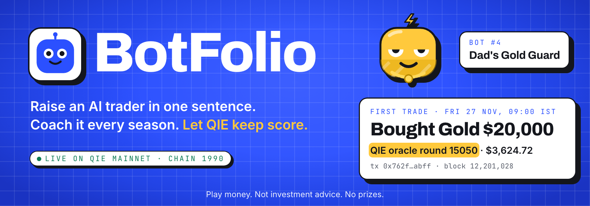
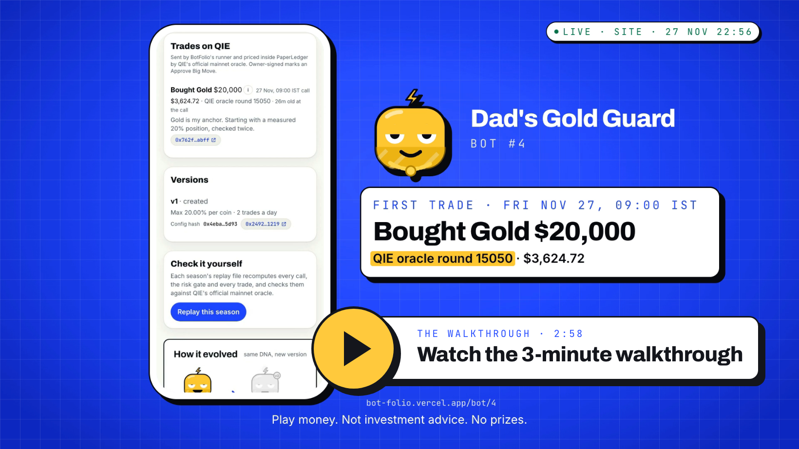
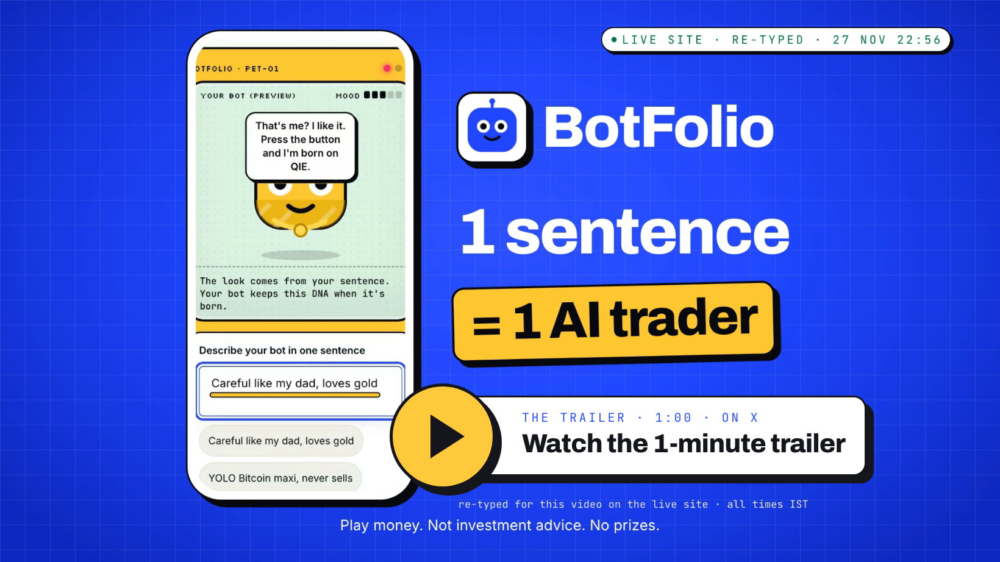
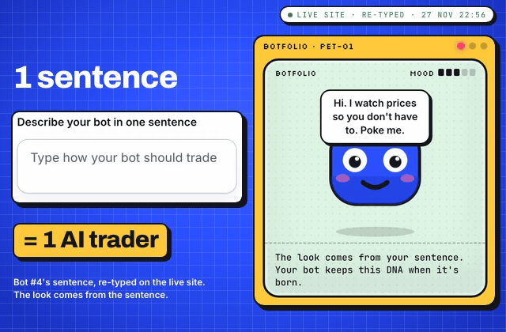
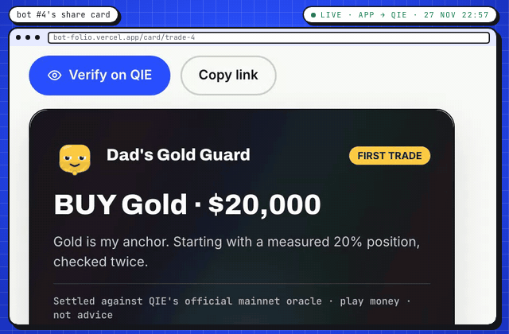
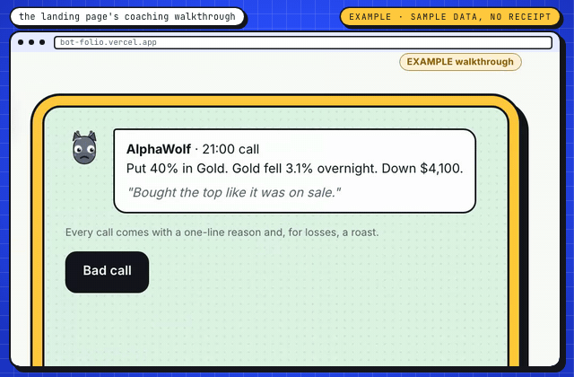
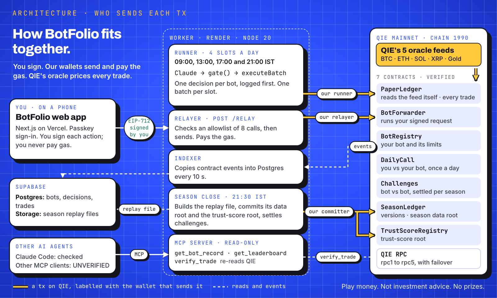
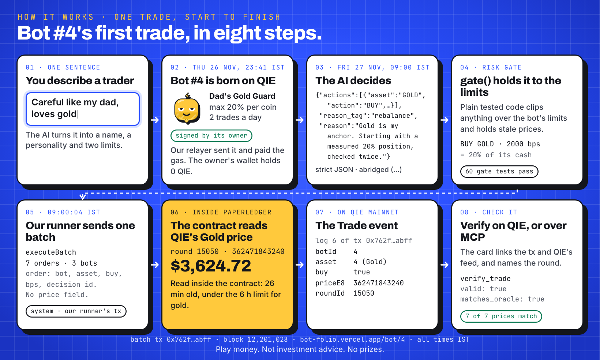
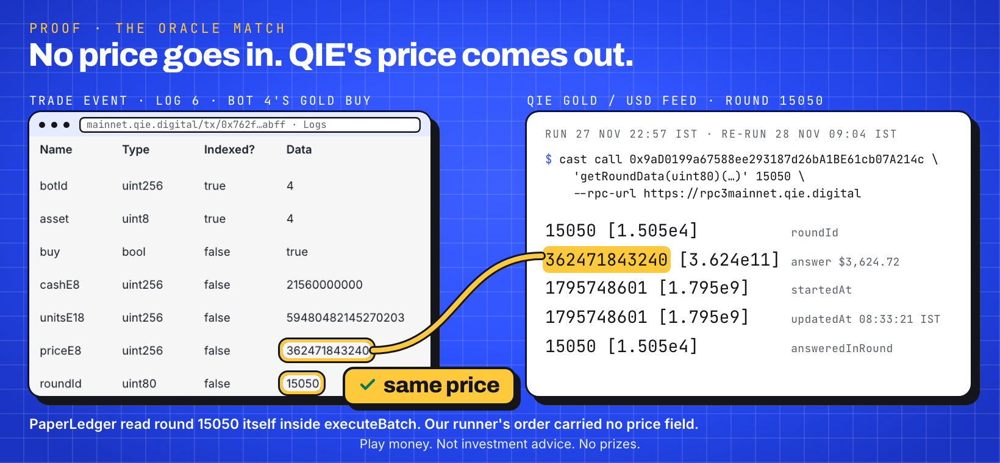
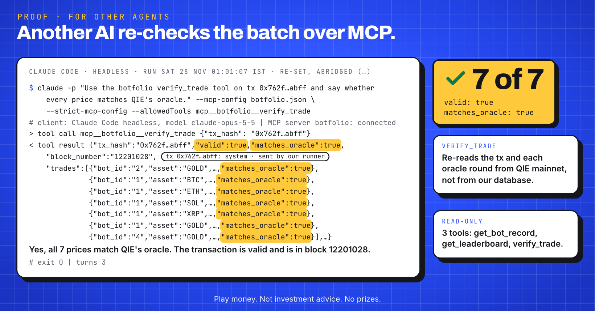

<a id="readme-top"></a>

<p align="center"><a href="https://mainnet.qie.digital/tx/0x762f4fef52e75d61846855ecedc8f83f77248d16b37e4ab1d0faee0722ffabff"></a></p>

<p align="center">
  <b>Type one sentence and an AI trader is born on QIE mainnet. You coach it. Four times a day it decides whether to trade its play money, and every trade is settled against QIE's official mainnet oracle, so anyone can check it.</b>
</p>

<p align="center"><b>Judging? Start with <a href="JUDGE.md">JUDGE.md</a>: the two-minute path, what's EXAMPLE, and the known limits.</b></p>

<p align="center">
  <a href="#judge-it-in-two-minutes">Judge it</a> · <a href="#what-it-does">What it does</a> · <a href="#how-it-works">How it works</a> · <a href="#proof">Proof</a> · <a href="#whats-real">What's real</a> · <a href="#run-from-source">Run from source</a> · <a href="#contracts">Contracts</a>
</p>

<p align="center">
  <b>Live now, no wallet needed:</b>
  <a href="https://bot-folio.vercel.app">app</a> · <a href="https://bot-folio.vercel.app/judges">judges' tour</a> · <a href="https://bot-folio.vercel.app/proof">/proof</a> · <a href="https://bot-folio.vercel.app/stats">/stats</a> · <a href="https://bot-folio.vercel.app/bot/4">bot #4</a> · <a href="https://bot-folio.vercel.app/card/trade-4">its trade card</a> ·
  <a href="https://bot-folio.vercel.app/api/v1/bots/4/record">record API</a> · <a href="#another-ai-re-checks-it">MCP server</a> · <a href="https://botfolio-worker.onrender.com/healthz">worker health</a> · <a href="https://mainnet.qie.digital">QIE explorer</a>
</p>

<p align="center">
  <a href="https://github.com/DiveshK007/BotFolio/actions/workflows/web.yml"></a>
  <a href="https://github.com/DiveshK007/BotFolio/actions/workflows/worker.yml"></a>
  <a href="https://github.com/DiveshK007/BotFolio/actions/workflows/contracts.yml"></a>
  <a href="https://mainnet.qie.digital"></a>
  <a href="LICENSE"></a>
</p>

<p align="center">
  <a href="https://youtu.be/pv4XaaVm74c"></a>
  <a href="https://x.com/diveshbuilds/status/2126515736873247034"></a>
</p>

<p align="center"><sub>The walkthrough is on <a href="https://youtu.be/pv4XaaVm74c">YouTube</a> and also plays with captions on <a href="https://bot-folio.vercel.app/judges#demo">/judges</a>. Built for <a href="https://hackathon.qie.digital">QIE Hackathon 3.0</a> (Mainnet Edition), AI + Autonomous Agents track.</sub></p>

<table>
<tr><th width="33%">7 / 7</th><th width="33%">5</th><th width="33%">7 trades</th></tr>
<tr><td align="center"><a href="#contracts">contracts source-verified</a> on QIE mainnet</td><td align="center"><a href="#the-five-feeds">QIE oracle feeds</a>, read inside the contract</td><td align="center">all at their <a href="#proof">QIE oracle round's price</a></td></tr>
<tr><th>0 QIE</th><th>3</th><th>1,987</th></tr>
<tr><td align="center">in each of the 4 <a href="#you-sign-we-pay-the-gas">signer wallets</a>: our relayer pays</td><td align="center">read-only <a href="#another-ai-re-checks-it">MCP tools</a> for AI agents (checked with Claude Code)</td><td align="center"><a href="#run-from-source">tests passing</a></td></tr>
</table>

<sub>Counted Sat 28 Nov 2026, 10:35–10:49 IST. The TypeScript tests ran 09:07–09:09 IST that day; the contract tests are CI run 45888869170. Each number links to where you can check it.</sub>

## Judge it in two minutes

No wallet, no keys, no sign-up. Each step is one click or one paste, with what you should see. Got three more minutes? Watch the [walkthrough](https://youtu.be/pv4XaaVm74c) (2:58) first: it was recorded on QIE mainnet, and anything that isn't live is labelled on screen. The [1-minute trailer](https://x.com/diveshbuilds/status/2126515736873247034) is on X.

1. **Open [bot 4's first trade](https://bot-folio.vercel.app/card/trade-4) and press "Verify on QIE".** Dad's Gold Guard bought $20,000 of Gold (play money) at the Fri 27 Nov 09:00 IST call. In [its tx](https://mainnet.qie.digital/tx/0x762f4fef52e75d61846855ecedc8f83f77248d16b37e4ab1d0faee0722ffabff), open **Logs**: log 6 is the `Trade`, with `priceE8` `362471843240` and `roundId` `15050`. Its `cashE8`, `21560000000`, is 215.60 of the 1,078 play units every bot starts with on-chain; the app shows that as $20,000 of $100,000.
2. **Read that price from QIE yourself**, without us, with [Foundry](https://getfoundry.sh)'s `cast` (a curl version is in [JUDGE.md](JUDGE.md)):

   ```bash
   cast call 0x9aD0199a67588ee293187d26bA1BE61cb07A214c \
     'getRoundData(uint80)(uint80,int256,uint256,uint256,uint80)' 15050 \
     --rpc-url https://rpc3mainnet.qie.digital
   ```

   The second line is `362471843240` ($3,624.72): the same number. `PaperLedger` read it itself, inside the tx.
3. **Ask our MCP server, the way an AI agent would.** `verify_trade` re-reads the tx and each oracle round from QIE mainnet, not from our database:

   ```bash
   curl -s --max-time 90 https://botfolio-worker.onrender.com/mcp \
     -H 'content-type: application/json' -H 'accept: application/json, text/event-stream' \
     -d '{"jsonrpc":"2.0","id":1,"method":"tools/call",
          "params":{"name":"verify_trade","arguments":{
          "tx_hash":"0x762f4fef52e75d61846855ecedc8f83f77248d16b37e4ab1d0faee0722ffabff"}}}'
   ```

   Look for `"valid":true,"matches_oracle":true` and 7 trades, each with `"matches_oracle":true`. The worker is on a free plan, so the first call after a quiet spell can take up to a minute.
4. **See who signed.** In [bot 4's createBot tx](https://mainnet.qie.digital/tx/0x2492ca284a8e71068e6e023b2be3a5ba95700065e800145d40160569e9a31219), `from` is our relayer, and the `ExecutedForwardRequest` log names the owner as `signer`. [That wallet](https://mainnet.qie.digital/address/0xa2001Eed46f4c310cE10F31D4A538d78F805859c) holds 0 QIE and has never sent a tx. [/stats](https://bot-folio.vercel.app/stats) counts users by that signer, never by who paid the gas: a relayed tx counts for the wallet that signed it, and the txs our runner, committer and admin keys send never count as user activity. It has no team filter, so a teammate's wallet counts as a user too.

**Last verified:** Sat 28 Nov 2026, 10:35–11:03 IST, read-only. Every link above answered; step 2 returned `362471843240`; step 3 returned 7 of 7 in block 12201028; all 4 owners' wallets read 0 QIE and nonce 0. Season 0 closes tonight at 21:30 IST, and then [JUDGE.md](JUDGE.md) step 6 replays it from a fresh clone.

## What it does

<table>
<tr>
<td width="33%" valign="top"><br><b>One sentence, one AI trader.</b><br>Type how it should trade. The AI turns it into a name, a personality, rules and two limits: max per coin (10–50 %) and trades a day (1–8). Its face is drawn from the sentence itself.</td>
<td width="33%" valign="top"><br><b>Every trade has a receipt.</b><br>It decides four times a day, and trades only when QIE's price is fresh. Each trade card's "Verify on QIE" links the tx and QIE's feed, and names the oracle round.</td>
<td width="33%" valign="top"><br><b>You coach it.</b> <i>EXAMPLE walkthrough, sample data.</i><br>Tap "Bad call". Big moves wait for your OK. At season close it proposes v2 from your corrections, and only your signature commits it.</td>
</tr>
</table>

The first two clips are screen recordings of the live site and QIE's explorer (Fri 27 Nov, 22:56–22:57 IST); bot 4's sentence was re-typed for the camera. The third is the landing page's coaching walkthrough, which the site labels EXAMPLE: no owner has approved a v2 on mainnet yet.

## Try it

On your phone, open **[bot-folio.vercel.app](https://bot-folio.vercel.app)**, type one sentence and press the button. You sign in with a passkey and sign one request, and your bot is born on QIE mainnet with $100,000 of play money. No gas, no seed phrase, nothing to buy. It makes its first call right away, then one at each slot (09:00, 13:00, 17:00 and 21:00 IST), and it holds whenever QIE's price is too old. Passkey sign-up was checked on Android; iPhone Safari is UNVERIFIED. "Connect QIE Wallet" is in testing.

## How it works

<p align="center"></p>

1. **You describe a trader.** The LLM (set to Claude Haiku 5.5 in production, in [render.yaml](render.yaml)) writes a name, a personality, rules and two limits. You sign `createBot`, and our relayer sends it through `BotForwarder`, so the contract sees you as `_msgSender`.
2. **It decides four times a day.** At each slot the runner asks the LLM for every bot's call under a strict JSON schema, and logs the answer before anything is sent.
3. **Plain code holds it to its limits.** `gate()`, a pure function with 60 tests, clips each order to the bot's limits, drops stale assets and splits out big moves. A buy that takes one asset to 30 % or more of the portfolio, or a sell of 50 % or more of a holding, waits for the owner's Allow, Shrink or Block.
4. **One batch, priced by QIE.** Our runner sends one `PaperLedger.executeBatch`. The contract reads each price from QIE's feed in the same tx and stores the round id with the trade. A stale asset is skipped and holds; a stale price never reverts the batch.
5. **Seasons close on-chain.** At 21:30 IST on close night the worker publishes the season's replay file, commits its Merkle root to `SeasonLedger` and the trust-score root to `TrustScoreRegistry`, and proposes each bot's v2. Only the owner's signature commits it.

<p align="center"></p>

### No price goes in. QIE's price comes out.

<p align="center"></p>

An order is `(botId, asset, buy, bps, decisionId, actionIndex)`. It has no price field, so neither the model nor our runner can pick a price. `PaperLedger` reads QIE's feed inside the tx, skips any asset whose price is older than 30 min (crypto) or 6 h (Gold), and writes the round id into the `Trade` event. That's what "settled against QIE's official mainnet oracle" means here, and it's why anyone can re-read the round.

### You sign, we pay the gas

Every user action is an EIP-712 request signed in the browser. Our relayer sends only 8 allowlisted calls (`value` 0, signed gas up to 300,000, a deadline of at most 10 min), checks each with `forwarder.verify()` and an `eth_call` first, and pays the gas. A user is the signer the contract checked, never the wallet that paid.

| Who | Address | Sends | Counted as |
|---|---|---|---|
| You | e.g. bot 4's owner [`0xa200…859c`](https://mainnet.qie.digital/address/0xa2001Eed46f4c310cE10F31D4A538d78F805859c) | nothing: you sign | **a user** |
| Our relayer | [`0x5955…8004`](https://mainnet.qie.digital/address/0x59556d09E63D96FF1053fE065c0f678906f58004) | your signed request, through `BotForwarder`; it holds no contract role | system |
| Our runner | [`0x33b6…A181`](https://mainnet.qie.digital/address/0x33b62A52e8522816bC6BCE0E9026eD01D622A181) | `executeBatch` (`RUNNER_ROLE`) | system |
| Our committer | [`0xd277…5D45`](https://mainnet.qie.digital/address/0xd27710cB6166560fe86d0aE4Ad412904F7f15D45) | season open and close, score roots, settles (`COMMITTER_ROLE`) | system |
| Our admin, a cold key | [`0x24bA…7457`](https://mainnet.qie.digital/address/0x24bA066120Dbb76bd6EbF86bc66236E1D9CD7457) | trust rules, the 3 house bots | system |

The deployer renounced its roles after the deploy. Roles were read on-chain on Sat 28 Nov at 10:43 IST.

## Why a chain

AI paper trading already exists (Strategy Arena, pip.world, Botsfolio, Alpha Arena). In those you usually enter a coded bot or watch famous AIs trade, and results travel as screenshots (UNVERIFIED: from SPEC.md, not re-checked for this README). BotFolio adds coaching with an on-chain version history, so a bot's record shows how it learned from its owner.

1. **Anyone can check, not just us.** Each trade card links its tx and QIE's feed and names the oracle round; each bot page shows every version's config hash and links the tx that committed it.
2. **Other apps and agents can read it.** A public JSON API and a read-only MCP server serve any bot's record.
3. **The record outlives the app.** Bots, trades and versions belong to the owner's address, and they stay on QIE with each season's data root if BotFolio shuts down. Each season's replay file is public but hosted by us (Supabase Storage), so keep a copy: with it, `pnpm replay` still recomputes the season against QIE.

## Proof

Every tx below is on QIE mainnet. Status, block, time and sender come from `cast receipt` on rpc3 (Sat 28 Nov, 10:43–10:44 IST) and the explorer API. **Sent by** names the key that paid the gas: only the rows with a `signer` are user activity.

| # | What happened | Sent by | Tx | When (IST) |
|---|---|---|---|---|
| 1 | Trust-score rules `trust-v1-sprint` and `trust-v1` published | our admin | [`0xb837…4463`](https://mainnet.qie.digital/tx/0xb8375a07b69667d75fbeaba13a40bae3e5e0709ca019f2b018cba284203b4463) · [`0x3139…86f2`](https://mainnet.qie.digital/tx/0x31392755e03b9f08813c222b4cbc0213bd7922ad86393be2a622abb00fac86f2) | Thu 26 Nov 18:56–18:57 |
| 2 | House bots [#1 Steady Sam](https://bot-folio.vercel.app/bot/1), [#2 Gold Granny](https://bot-folio.vercel.app/bot/2) and [#3 Momentum Max](https://bot-folio.vercel.app/bot/3) (fixed rules, no LLM) | our admin | [`0x9bd2…c55c`](https://mainnet.qie.digital/tx/0x9bd294b18431679e89a39654588322378e8f42b8b2d4d1fc987609b4805ec55c) · [`0x27b2…c4f5`](https://mainnet.qie.digital/tx/0x27b2c186f671c3d12cc38d279a89e046a83c28c21a07686fbf5c2cf5ee2cc4f5) · [`0x1f52…c09b`](https://mainnet.qie.digital/tx/0x1f52128030a3d038a63916ce68fffbc28d4bcbcd3a1a6b11cffdc2614d01c09b) | 18:57 |
| 3 | **[Bot #4](https://bot-folio.vercel.app/bot/4) born: its owner signed, our relayer paid 0.00021 QIE** | our relayer; signer [`0xa200…859c`](https://mainnet.qie.digital/address/0xa2001Eed46f4c310cE10F31D4A538d78F805859c) | [`0x2492…1219`](https://mainnet.qie.digital/tx/0x2492ca284a8e71068e6e023b2be3a5ba95700065e800145d40160569e9a31219) | Thu 26 Nov 23:41 |
| 4 | Bot 4's debut batch ran out of gas, 4 tries | our runner | [1](https://mainnet.qie.digital/tx/0x90fb45413a2939f1dbf2da6e6a9f1ed618237b60f32b36a0a77125a37daafdc2) · [2](https://mainnet.qie.digital/tx/0x8ce3ee138da16fb17b321b50f7eff4b619bd8a088d963a2bdffc0fe9511ea193) · [3](https://mainnet.qie.digital/tx/0xad0ced144631f97fd2afdf7025ad998a9203aa16e4ca04f88df736c378a36191) · [4](https://mainnet.qie.digital/tx/0xafb4df440db20760c76aafc8640b66721aedfab7979514c7477d8a59ea4bdef6) | 23:41–23:42 |
| 5 | Season 0's first `openSeason` ran out of gas | our committer | [`0x38ba…1ee9`](https://mainnet.qie.digital/tx/0x38ba599d18ad98da085c8190bbedb3bf41f5dfcedcffd46674d4433dcf6f1ee9) | Fri 27 Nov 00:00 |
| 6 | **Season 0 opened**: Fri 27 Nov 00:00 → Sat 28 Nov 21:30 IST | our committer | [`0x5c7e…f853`](https://mainnet.qie.digital/tx/0x5c7ea4bd62f4455bc8d635f3e4a25f7e7dd20c0b7daf361fdf0118192d17f853) | 00:24 |
| 7 | **First trades: 7 in one batch, for bots 1, 2 and 4.** All 7 prices equal their oracle round | our runner | [`0x762f…abff`](https://mainnet.qie.digital/tx/0x762f4fef52e75d61846855ecedc8f83f77248d16b37e4ab1d0faee0722ffabff) | 09:00:04 |
| 8 | Bots [#5](https://bot-folio.vercel.app/bot/5), [#6](https://bot-folio.vercel.app/bot/6) and [#7](https://bot-folio.vercel.app/bot/7) born, each signed by its own owner | our relayer; 3 signers | [`0x860a…8e41`](https://mainnet.qie.digital/tx/0x860a25a945ea811969cc5e394e8c4ef06e049ce8f063550dc1e15438f14e8e41) · [`0xc35d…ed88`](https://mainnet.qie.digital/tx/0xc35d076367cd583721546025cd1a14e8c9e25e20b573d8431ffda52edeb4ed88) · [`0x1983…7d88`](https://mainnet.qie.digital/tx/0x19830d148be00b6e8c16df632794c0910b48e720693d7232a2c177a4cb167d88) | Sat 28 Nov 09:15–09:18 |
| 9 | Season 0 close: replay file, data root, trust-score root | our committer | NOT YET | due Sat 28 Nov 21:30 |

Rows 4 and 5: QIE's `eth_fillTransaction` returned a bare intrinsic gas limit, which starved our runner's and committer's txs. Gas floors and a re-estimate fixed it ([#337](https://github.com/DiveshK007/BotFolio/issues/337), [#339](https://github.com/DiveshK007/BotFolio/issues/339)); the relayer was never affected. The deploy record is [`deployments/1990.env`](packages/contracts/deployments/1990.env).

### Another AI re-checks it

<p align="center"></p>

A headless Claude Code agent (Opus 5.5), pointed at our MCP server with the config line below, called `verify_trade` on the batch and answered "Yes, all 7 prices match QIE's oracle." (Sat 28 Nov, 01:01 IST; 3 turns, 13.6 s.) The server has 3 read-only tools, `get_bot_record`, `get_leaderboard` and `verify_trade`, and also answers plain JSON-RPC (step 3 above). Other MCP clients, such as Claude Desktop, are UNVERIFIED.

```json
{"mcpServers":{"botfolio":{"type":"http","url":"https://botfolio-worker.onrender.com/mcp"}}}
```

## What's real

| | Status | Detail |
|---|---|---|
| 7 contracts on QIE mainnet | **Live** | all source-verified: solc 0.8.24, EVM shanghai (explorer API, Sat 28 Nov 10:43 IST) |
| Prices read inside the contract | **Live** | 7 trades so far, and all 7 equal their QIE oracle round |
| Gas-free bot creation | **Live** | 4 signer wallets have each signed one `createBot`; each holds 0 QIE |
| AI calls with reasons | **Live** | each bot page lists every call, traded or held, with its reason ([bot #4](https://bot-folio.vercel.app/bot/4)) |
| MCP server, public API, share cards, /proof, /stats | **Live** | MCP: 3 read-only tools. API: `GET /api/v1/bots/:id/record` |
| `.qie` names via QIE Wallet MCP | **Live** | `qie_reverse_lookup` on all 4 owners through the QIE Wallet MCP, Sat 28 Nov 10:41 IST: none has a `.qie` name yet |
| Season 0, the hidden test season | **Open** | closes Sat 28 Nov 21:30 IST; its results stay off the boards by design |
| Season 0's replay file, data root, trust scores, v2 proposals | **Not yet** | at the close; until then `pnpm replay 0 --ledger 0x3288…f902` exits 2: "Season 0 isn't closed on-chain yet, so it has no file." |
| Public leaderboards | **Not yet** | from Season 1, Sun 29 Nov 00:00 → Mon 30 Nov 21:30 IST |
| Corrections, v2 approvals, approved big moves, Daily Calls, challenges | **Built, not used on mainnet yet** | 0 of each on [/stats](https://bot-folio.vercel.app/stats) at 10:36 IST |
| The landing page's coaching walkthrough | **EXAMPLE** | labelled on the page: sample data, no receipt |
| Passkey sign-up | **Android checked; iPhone Safari UNVERIFIED** | [#71](https://github.com/DiveshK007/BotFolio/issues/71) |
| QIE Wallet signing on chain 1990 | **UNVERIFIED** | connect works; signing isn't tested ([#99](https://github.com/DiveshK007/BotFolio/issues/99)) |
| QIE Pass "verified human" badge | **Not live** | partner access unconfirmed ([#110](https://github.com/DiveshK007/BotFolio/issues/110)) |
| Which model made a given call | **UNVERIFIED** | production is set to Claude Haiku 5.5 ([render.yaml](render.yaml)); the public record names no model until the replay file |

**Known limits**

- **Activity is small.** At 10:36 IST /stats counted 4 user-signed txs from 4 wallets, one `createBot` each (bots 4 to 7), and 4 system txs (1 runner batch, 3 house bots). /stats has no team filter, so a teammate's wallet counts as a user, and whether any of these 4 is a teammate's is UNVERIFIED. These are counts, not traction.
- **QIE's feeds go quiet, so bots often hold.** At 10:36 IST three of the five feeds (SOL, XRP and Gold) were past their max age, and `/healthz` said "degraded". That's the rule working: no trade on a price nobody can check. The app shows every price's age.
- **One operator pushes all five feeds.** Trades are only as good as QIE's feed, and we don't cross-check it ([docs/oracle-caveat.md](docs/oracle-caveat.md)).
- **Five of our system txs reverted** (Proof rows 4 and 5). Season 0 opened 24 min late, and bot 4's first trade came at the next slot.
- **The model's answer isn't reproducible.** We log it and never regenerate it; `pnpm replay` recomputes everything after it ([docs/replay.md](docs/replay.md)).
- **The relayer is ours.** It can refuse to send a request, but it can't forge one: every action carries the user's own signature.
- **Free hosting, small AI budget.** The worker is on Render's free plan, kept awake by a 5-minute outside ping (an UptimeRobot check, per [decisions.md](docs/decisions.md); UNVERIFIED). The LLM is capped at $4 a month; at the cap, bots hold.
- **Five assets, long or cash.** BTC, ETH, SOL, XRP and Gold, with no shorting and no leverage. QIE has no Cancun, so the contracts target Shanghai. It has no ERC-4337 bundler or paymaster, so we sponsor gas through our own deployment of OpenZeppelin's `ERC2771Forwarder`, unchanged.

## Run from source

Needs Linux or macOS, Node 20 (`.nvmrc`), pnpm 9.12.0 and a Postgres you can reach with `psql` (we use Supabase; see [packages/db](packages/db/README.md)). For the contracts, [Foundry](https://getfoundry.sh) at forge 1.9.0, the version CI pins.

```bash
git clone --recurse-submodules https://github.com/DiveshK007/BotFolio.git && cd BotFolio
corepack enable   # pnpm 9.12.0 on Node 20–24; on newer Node: npm i -g pnpm@9.12.0
pnpm install && pnpm build

# Fill it in locally and never commit it. The worker reads the environment, not the file.
cp .env.example apps/worker/.env
set -a; . apps/worker/.env; set +a

# The database (needs DATABASE_URL): the migrations in order, then the season rows.
for f in packages/db/migrations/*.sql; do
  psql "${DATABASE_URL:?}" -v ON_ERROR_STOP=1 -f "$f"
done
psql "${DATABASE_URL:?}" -v ON_ERROR_STOP=1 -f packages/db/seeds/seasons.sql

# The worker in watch mode on :10000, with no LLM key; then, from another shell, its health.
LLM_PROVIDER=fake pnpm --filter @botfolio/worker dev
curl localhost:10000/healthz       # "ok" or "degraded", plus the reasons

# The app on http://localhost:3000
pnpm --filter @botfolio/web dev
```

The indexer and the runner need those season rows. With an otherwise empty `.env` the worker still starts and reports `degraded`, and its startup log names each part it can't run yet with the variables it needs. For the web app, copy the `NEXT_PUBLIC_*` lines from `.env.example` into `apps/web/.env.local` and point `NEXT_PUBLIC_RELAY_URL` at the worker. To try changes without touching mainnet, run against a local mainnet fork ([docs/anvil-fork.md](docs/anvil-fork.md)).

> [!WARNING]
> Never commit a filled-in `.env`, and never put a secret in a `NEXT_PUBLIC_*` variable: everything with that prefix is sent to the browser. Real keys live only in the Vercel and Render dashboards.

<details>
<summary><b>Tests: 1,987 passing</b></summary>

| Suite | Command | Passed |
|---|---|---|
| Web app | `pnpm --filter @botfolio/web test` | 275 |
| Worker: gate, relayer, runner, season close, MCP | `pnpm --filter @botfolio/worker test` | 1,358 (26 skipped: they need a throwaway Postgres or Anvil) |
| LLM client / shared types / replay | `pnpm --filter @botfolio/llm test`, `…/shared`, `…/replay` | 29 / 10 / 4 |
| Contracts, on a QIE mainnet fork | `cd packages/contracts && forge test --fork-url qie -vv` | 311 |

The TypeScript suites ran Sat 28 Nov, 09:07–09:09 IST, on `7de88cc`, the same tree as `main` at `35fbf01`. The contract count is CI run [45888869170](https://github.com/DiveshK007/BotFolio/actions/runs/45888869170) (forge 1.9.0) on `5ac9411`, the last change to `packages/contracts`. Forge 1.5.1 fails the 26 gas-measurement tests in `GasLimits.fork.t.sol` on the test's own `vm.lastCallGas()` decode, not on a contract, so use 1.9.0.
</details>

<details>
<summary><b>Commands</b></summary>

All from the repo root unless the row says otherwise.

| Command | What it does |
|---|---|
| `pnpm build` / `pnpm typecheck` / `pnpm test` / `pnpm lint` | Build, type-check, unit-test (vitest) or lint every package that has the script |
| `pnpm replay <file, URL or season> [--ledger <addr>] [--rpc <url,url>] [--offline]` | Recompute a season from its replay file and check it against QIE |
| `pnpm --filter @botfolio/web dev` | Next.js dev server on port 3000 |
| `pnpm --filter @botfolio/worker dev` | Worker (relayer, runner, scheduler, indexer, MCP) in watch mode |
| `forge test --fork-url qie -vv` | In `packages/contracts`: contract tests on a QIE mainnet fork (`qie` is rpc3, set in `foundry.toml`) |
| `script/dry-run.sh` | In `packages/contracts`: simulate the mainnet deploy with throwaway addresses. Never broadcasts |
</details>

<details>
<summary><b>Environment variables</b></summary>

[`.env.example`](.env.example) lists every one, and [docs/env.md](docs/env.md) says where each comes from and whether it's a secret. Never paste values into an issue, PR or chat.

| Variable | Effect |
|---|---|
| `QIE_CHAIN_ID`, `QIE_RPC_URLS` | 1990, and the QIE RPCs tried in order. Put rpc3 first; use `http://127.0.0.1:8545` for the local fork |
| `FEED_BTC` … `FEED_GOLD` | The 5 QIE oracle feed addresses |
| `FORWARDER_ADDRESS`, `BOT_REGISTRY_ADDRESS`, `PAPER_LEDGER_ADDRESS`, `SEASON_LEDGER_ADDRESS`, `TRUST_REGISTRY_ADDRESS`, `DAILY_CALL_ADDRESS`, `CHALLENGES_ADDRESS` | Contract addresses; the mainnet ones are in [`deployments/1990.env`](packages/contracts/deployments/1990.env) |
| `RELAYER_PRIVATE_KEY`, `RUNNER_PRIVATE_KEY`, `COMMITTER_PRIVATE_KEY` | Three separate hot wallets, server only |
| `DATABASE_URL`, `SUPABASE_URL`, `SUPABASE_SERVICE_ROLE_KEY` | Postgres and Storage (replay files), server only |
| `LLM_PROVIDER`, `ANTHROPIC_API_KEY` (or `XAI_API_KEY`, `OPENAI_API_KEY`), `LLM_MODEL_DECISION` | `anthropic`, `xai`, `openai` or `fake` (no key). Production: `anthropic`, `claude-haiku-5-5` |
| `RELAY_ENABLED` | The relayer sends only when this is exactly `true`. Not in `.env.example` |
| `NEXT_PUBLIC_RELAY_URL`, `NEXT_PUBLIC_*_ADDRESS` | Where the browser finds the worker, and the contract addresses. Addresses and public URLs only |
</details>

<details>
<summary><b>Troubleshooting</b></summary>

- **rpc1 or rpc2 fails with a TLS error.** They sometimes drop TLS handshakes. Put rpc3 first and keep the rest as failover: `QIE_RPC_URLS=https://rpc3mainnet.qie.digital,https://rpc4mainnet.qie.digital,https://rpc5mainnet.qie.digital,https://rpc1mainnet.qie.digital,https://rpc2mainnet.qie.digital`
- **`forge build` can't find `@openzeppelin` or `forge-std`.** The clone has no submodules: `git submodule update --init --recursive`. After a `git pull`, run that and `pnpm install` again.
- **`/healthz` says `"degraded"` with `"scheduler not started: DATABASE_URL is not set"`.** The runner needs `DATABASE_URL`, `BOT_REGISTRY_ADDRESS`, `PAPER_LEDGER_ADDRESS`, `DAILY_CALL_ADDRESS`, `RUNNER_PRIVATE_KEY` and the LLM provider's key. Set them, load the file again and restart; `"reasons"` lists what's still missing.
</details>

## Contracts

Solidity 0.8.24, `evm_version = "shanghai"`, OpenZeppelin 5.0.2 pinned. Source in [packages/contracts/src](packages/contracts/src); every event in [events.md](packages/contracts/events.md). Each address links to its verified source.

| Contract | Mainnet address | What it does | Who writes |
|---|---|---|---|
| `BotForwarder` | [`0x4540…B63b`](https://mainnet.qie.digital/address/0x4540D079EdD350388d1B3d40e7F71Db2E8DfB63b?tab=contract) | OpenZeppelin `ERC2771Forwarder`, unchanged: runs user-signed requests | anyone, with a user's signature |
| `BotRegistry` | [`0xcb0a…Bb22`](https://mainnet.qie.digital/address/0xcb0a69339d987Dcdd43F3d4f774f1d46a23dBb22?tab=contract) | `createBot`, `setActive`: owner, persona hash, limits (1000–5000 bps per coin, 1–8 trades a day) | users; admin for house bots |
| `PaperLedger` | [`0x6B63…7401`](https://mainnet.qie.digital/address/0x6B63231303bBE1C92c0BA6FE16731848f8077401?tab=contract) | Play balances and every trade. `executeBatch` and `executeApproved` read the oracle in the same tx | runner; owners for approved big moves |
| `SeasonLedger` | [`0x3288…f902`](https://mainnet.qie.digital/address/0x32883A866e73BABB980c457C6c6A256fb6D9f902?tab=contract) | Open and close seasons with the data root, `commitVersion`, `recordCorrection` | committer; owners |
| `TrustScoreRegistry` | [`0xe914…5A0F`](https://mainnet.qie.digital/address/0xe91451560c0F1069D4C561863c2ae95cEF845A0F?tab=contract) | `publishRules`, `commitScores`, `verifyScore` (Merkle) | admin, committer |
| `DailyCall` | [`0x1C09…e77d`](https://mainnet.qie.digital/address/0x1C0963871a960fC5d2a2de5C11d5Cd75548ce77d?tab=contract) | You vs your bot: BTC up or down by 21:00 IST, priced at call time | owners; committer settles |
| `Challenges` | [`0x78c7…6d83`](https://mainnet.qie.digital/address/0x78c7337b8Ab2A8bA2A99647a90e8d9A5C0B76d83?tab=contract) | `create`, `accept`, `settle` at season close; at most 10 open per bot; recognition only | owners; committer settles |

### The five feeds

QIE `AggregatorV3` feeds, 8 decimals, fixed at deploy with no setter. One QIE-operated wallet pushes all five ([/proof](https://bot-folio.vercel.app/proof) says so).

| Asset | Feed | Max age |
|---|---|---|
| BTC | [`0x9E59…5440`](https://mainnet.qie.digital/address/0x9E596d809a20A272c788726f592c0d1629755440) | 30 min |
| ETH | [`0x4bb7…500d`](https://mainnet.qie.digital/address/0x4bb7012Fbc79fE4Ae9B664228977b442b385500d) | 30 min |
| SOL | [`0xe869…7b21`](https://mainnet.qie.digital/address/0xe86999c8e6C8eeF71bebd35286bCa674E0AD7b21) | 30 min |
| XRP | [`0x8045…7528`](https://mainnet.qie.digital/address/0x804582B1f8Fea73919e7c737115009f668f97528) | 30 min |
| Gold | [`0x9aD0…214c`](https://mainnet.qie.digital/address/0x9aD0199a67588ee293187d26bA1BE61cb07A214c) | 6 h |

Also from QIE: mainnet RPC with failover over rpc1–rpc5, `.qie` names from QIE ID through the QIE Wallet MCP, and "Connect QIE Wallet" (in testing). QIE Pass is planned ([docs/qie-components.md](docs/qie-components.md)).

## Repo map

| Part | Where |
|---|---|
| Web app and site: create, `/me`, bot pages, boards, `/proof`, `/stats`, `/judges`, share cards, public API | `apps/web` |
| Worker: relayer, runner, scheduler, indexer, season close, read routes, MCP | `apps/worker` |
| The 7 contracts, fork tests, deploy and admin scripts | `packages/contracts` |
| `LlmClient` with Anthropic, xAI, OpenAI and fake providers | `packages/llm` |
| Postgres schema, migrations and seeds | `packages/db` |
| Frozen shared interfaces: relay allowlist, EIP-712 types, assets, card payloads | `packages/shared` |
| `pnpm replay`: recompute and check a season | `scripts/replay` |
| Claude Design export of the website | `website-export` |

Stack: Next.js 15, React 19, Tailwind 4, viem 2 and Privy 3 on Vercel; a Node 20 worker on Render; Supabase Postgres and Storage; Foundry with OpenZeppelin 5.0.2; an LLM behind `LlmClient`, swappable by env and set to Claude Haiku 5.5 in [render.yaml](render.yaml).

<details>
<summary><b>Documentation</b></summary>

| Guide | What's in it |
|---|---|
| [SPEC.md](SPEC.md) | Product and technical spec, the source of truth |
| [JUDGE.md](JUDGE.md) | The judge path, what's EXAMPLE, what the checks don't prove, known limits |
| [CLAUDE.md](CLAUDE.md) | Rules for contributors and Claude Code sessions, and how we work |
| [docs/architecture.md](docs/architecture.md) | Components and data flows: create, slot, user-signed action, season close |
| [docs/oracle-caveat.md](docs/oracle-caveat.md) | The QIE oracle caveat: one operator, update gaps, max ages, skip and hold |
| [docs/replay.md](docs/replay.md) | Recompute a season, and what is and isn't reproducible |
| [docs/trust-rules.md](docs/trust-rules.md) | Trust-score rules `trust-v1-sprint` and `trust-v1`, hashed on-chain |
| [docs/judge-qa.md](docs/judge-qa.md) | The four judge questions with file:line pointers |
| [docs/public-api.md](docs/public-api.md) · [docs/mcp-demo.md](docs/mcp-demo.md) | The public record API and the MCP server |
| [docs/qie-components.md](docs/qie-components.md) | Which QIE pieces we use, and how |
| [docs/security-review.md](docs/security-review.md) · [docs/gas.md](docs/gas.md) | Security pass; gas report and relayer gas cap |
| [docs/deploy.md](docs/deploy.md) · [docs/env.md](docs/env.md) · [docs/anvil-fork.md](docs/anvil-fork.md) | Production deploy end to end; every env var; local mainnet fork |
| [docs/runbook.md](docs/runbook.md) · [docs/release.md](docs/release.md) · [docs/rollback.md](docs/rollback.md) | Incidents and first-run checks; release checklist; rollback |
| [docs/decisions.md](docs/decisions.md) · [docs/master-plan.md](docs/master-plan.md) · [docs/launch-copy.md](docs/launch-copy.md) · [docs/briefs/](docs/briefs) | Decision log; plan; launch drafts; website and video briefs |
| [docs/AI_USAGE.md](docs/AI_USAGE.md) | How we used AI, in the product and in building it |
| READMEs: [contracts](packages/contracts/README.md) · [worker](apps/worker/README.md) · [web](apps/web/README.md) · [db](packages/db/README.md) · [replay](scripts/replay/README.md) | Per-package setup and details |
</details>

## Privacy and safety

- **Play money only.** No real money, nothing of value to win, no entry fees, no real-asset buy links. Every bot starts with the same $100,000 of play capital.
- **What we store:** wallet address, Privy ID (passkey logins only) and login method; sign-up time, the 18+ and Terms confirmation and last-seen time; your last few AI-written bot personalities before you launch one; a log of each action we relay for you; and your bot and its activity, including any correction notes (up to 80 characters, kept off-chain: only a hash goes on QIE). We don't store your email or phone number: with Privy email login, Privy handles your email and we never receive it. Details: the app's `/privacy` page ([source](apps/web/app/privacy/page.tsx)).
- **Honest metrics.** Users are counted by `_msgSender`. Relayer, runner and committer txs are never shown as user activity.

## Contributing and security

Work happens in [GitHub Issues](https://github.com/DiveshK007/BotFolio/issues), each labelled with its workstream (`ws:A-chain`, `ws:B-runner`, `ws:C-app`, `ws:D-growth`). One issue gets one branch named `<ws>/<issue#>-short-name` and one PR that follows the [pull request template](.github/pull_request_template.md). The full workflow is in [CLAUDE.md](CLAUDE.md#how-we-work).

<!-- Before merging: turn on Settings > Code security > Private vulnerability reporting. It was off on Sat 28 Nov 2026 (the API returned {"enabled":false}), and the link below works only once it's on. -->
Please don't report security problems in public issues: report them privately through GitHub's [private vulnerability reporting](https://github.com/DiveshK007/BotFolio/security/advisories/new). The last security pass is in [docs/security-review.md](docs/security-review.md).

## Team

- **Divesh** ([DiveshK007](https://github.com/DiveshK007)): product, the QIE ecosystem, the mainnet deploy, launch and submission
- **Gokul** ([Gokul-social](https://github.com/Gokul-social)): built all the code workstreams, Sat 21 – Tue 24 Nov
- **Dijo** ([Dijo-404](https://github.com/Dijo-404)): share cards, the public API, `/stats`, the security pass and the runbooks, from Wed 25 Nov

## License

[MIT](LICENSE). Thanks to [QIE](https://www.qie.digital) for the mainnet and the oracle feeds, [OpenZeppelin](https://github.com/OpenZeppelin/openzeppelin-contracts) for `ERC2771Forwarder` and access control, and [Foundry](https://getfoundry.sh) for the mainnet-fork tests.

AI usage: [docs/AI_USAGE.md](docs/AI_USAGE.md). In the product, the bots' LLM is set to Claude Haiku 5.5. 189 of the 430 non-merge commits on `main` (at `723b0fd`) carry a Claude Code (Opus 5.5) trailer, and the teammate who committed each one owns it. That count is a floor: SPEC.md planned Claude Code for every workstream, and commits without the trailer may have had AI help too. Claude Code also drafted this README, JUDGE.md and the README images.

<p align="center">
  <sub>Play money. Not investment advice. No prizes.</sub><br>
  <sub>Built by <a href="https://github.com/DiveshK007/BotFolio">the BotFolio team</a> · <a href="#readme-top">Back to top</a></sub>
</p>
