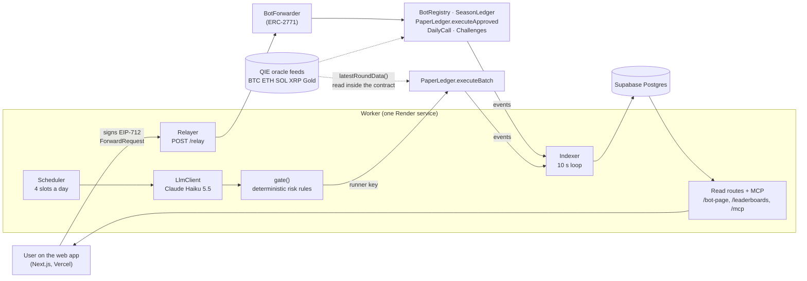

# Architecture

Play money. Not investment advice. No prizes. The contracts have been deployed and verified on QIE mainnet since Nov 26 2026. Their addresses are in the [README](../README.md#contracts) and [`deployments/1990.env`](../packages/contracts/deployments/1990.env).

## Components

| Component | Where | What it does |
| :--- | :--- | :--- |
| Web app | [`apps/web`](../apps/web), Vercel | Next.js 15 app: create, bot page, leaderboards, `/proof`, `/stats`, and the public read API ([`app/api/v1`](../apps/web/app/api/v1)). Signs EIP-712 requests in the browser. |
| Worker | [`apps/worker`](../apps/worker), one Render web service | Everything below, in one Node 20 process. |
| Relayer | [`src/relay`](../apps/worker/src/relay) | `POST /relay`: checks a signed request against an allowlist, then sends it through `BotForwarder`. |
| Runner | [`src/slot`](../apps/worker/src/slot), [`src/gate`](../apps/worker/src/gate) | Asks the LLM for each bot's decision, runs the pure `gate()`, sends `PaperLedger.executeBatch` with the runner key. |
| Scheduler | [`src/scheduler`](../apps/worker/src/scheduler) | `node-cron` jobs in UTC: slots and stale retries, season close and open, recap, Daily Call settle, big-move sweep ([`jobs.ts`](../apps/worker/src/scheduler/jobs.ts)). |
| Indexer | [`src/indexer`](../apps/worker/src/indexer) | A 10 s loop copying contract events into Postgres. |
| MCP and public routes | [`src/mcp`](../apps/worker/src/mcp), [`bot-page`](../apps/worker/src/bot-page), [`season`](../apps/worker/src/season), [`trust`](../apps/worker/src/trust) | Read-only: `POST /mcp`, bot pages, `GET /leaderboards`, `GET /trust/proof`. |
| Alerts | [`src/alerts`](../apps/worker/src/alerts) | POSTs to `ALERT_WEBHOOK_URL`; sends nothing when unset. |
| Database | Supabase Postgres + Storage | Schema in [`packages/db/schema.sql`](../packages/db/schema.sql). Storage holds replay files (public bucket, `REPLAY_BUCKET`). |
| Contracts | [`packages/contracts/src`](../packages/contracts/src), QIE mainnet, chain 1990 | `BotForwarder`, `BotRegistry`, `PaperLedger`, `SeasonLedger`, `TrustScoreRegistry`, `DailyCall`, `Challenges`. |
| LLM | [`packages/llm`](../packages/llm) | `LlmClient` with Anthropic, xAI (Grok), OpenAI and fake providers, chosen by `LLM_PROVIDER`. Production has run Claude Haiku 5.5 (`anthropic`) since Nov 26 (`docs/decisions.md`). |

Prices are read inside the contracts, never passed in. See [oracle-caveat.md](oracle-caveat.md).

## Data flows

### Create a bot

1. The browser sends the sentence to `POST /persona` ([`persona/route.ts`](../apps/worker/src/persona/route.ts)). The LLM returns a name, rules and two limits; the worker keeps the draft under its `personaHash`.
2. The user signs `BotRegistry.createBot(bytes32,uint16,uint8)` (EIP-712). The relayer sends it through `BotForwarder`, so the contract sees the user as `_msgSender`.
3. The debut watcher ([`slot/debut.ts`](../apps/worker/src/slot/debut.ts)) polls `nextBotId` every 2 s and starts the bot's first decision without waiting for the indexer. The indexer later confirms the `BotCreated` event into Postgres.

### A trading slot

1. The scheduler fires at 09:00, 13:00, 17:00 and 21:00 IST (`30 3,7,11,15 * * *` UTC).
2. [`runSlot`](../apps/worker/src/slot/run.ts) reads the oracle off-chain for the prompt and UI only, then decides each bot once (concurrency 10). The decision is written to Postgres before anything is sent.
3. `gate()` clips the output to the bot's limits, holds stale assets and splits out big moves ([`gate/gate.ts`](../apps/worker/src/gate/gate.ts)).
4. [`deliver`](../apps/worker/src/slot/deliver.ts) sends the rest in one `PaperLedger.executeBatch` with the runner key. The contract reads the feed itself. A stale feed or a failed check emits `OrderSkipped` and the batch carries on ([`PaperLedger.sol`](../packages/contracts/src/PaperLedger.sol)).
5. Stale retries run at +5, +10 and +15 min under the same order ids. The indexer copies `Trade` and `OrderSkipped` events to Postgres.

### A user-signed action

Create bot, correction, approve v2, Approve Big Move, Daily Call, challenge create or accept.

1. The browser signs a `ForwardRequest`. The relayer accepts only the 8 functions in [`RELAY_ALLOWLIST`](../packages/shared/src/relay.ts), with `value == 0` and a deadline within 10 minutes.
2. It checks with `forwarder.verify()` and an `eth_call`, then broadcasts from a nonce manager ([`relay/`](../apps/worker/src/relay)). It only sends when `RELAY_ENABLED=true`.
3. `BotForwarder` (OpenZeppelin `ERC2771Forwarder`) calls the target, which reads the user from `_msgSender`. The user pays no gas.
4. A big move waits for the owner. If the owner allows it, `PaperLedger.executeApproved` runs it. After the 2 h window the sweep ([`big-moves/sweep.ts`](../apps/worker/src/big-moves/sweep.ts)) sends the shrunk order instead, and `usedOrder` lets only one of the two execute.

### Season close

1. `season_close` runs at 21:30 IST (`0 16 * * *` UTC) and handles each `closing` season ([`season/close.ts`](../apps/worker/src/season/close.ts)).
2. It computes results and battle ranks, then trust scores and their root ([`trust/scores.ts`](../apps/worker/src/trust/scores.ts)), and commits them with `TrustScoreRegistry.commitScores`.
3. It builds `season-<n>.jsonl` ([`replay-file.ts`](../apps/worker/src/season/replay-file.ts)), checks it with `verifyOffline`, uploads it to Supabase Storage and sends `SeasonLedger.closeSeason(season, root, uri)`.
4. Challenges are settled or expired. Each step compares with the chain first, so a re-run sends nothing twice.
5. v2 proposals are generated for each active bot ([`src/v2`](../apps/worker/src/v2)). The owner approves with `SeasonLedger.commitVersion`.

Anyone can then recompute the season: [replay.md](replay.md). Trust score rules: [trust-rules.md](trust-rules.md).

## Not covered

Privy passkey sign-in on chain 1990 is live. By Nov 27 it was checked on Android; iPhone Safari is UNVERIFIED ([#71](https://github.com/DiveshK007/BotFolio/issues/71)). The relayer, runner and committer are three separate wallets in production: 0x5955…8004, 0x33b6…A181 and 0xd277…5D45 (`docs/decisions.md`, Nov 26). UNVERIFIED until the S0 close on Nov 28: the order of `commitScores` and `closeSeason` on-chain. In the code, `closeSeasons` commits the scores first.
